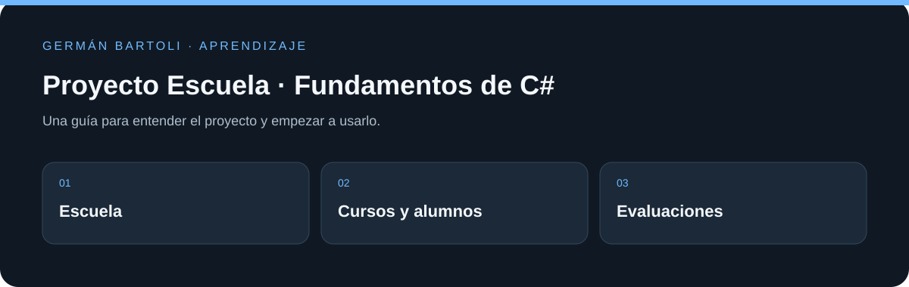

# Proyecto Escuela · Fundamentos de C#

**Modelo de escuela, cursos, alumnos, asignaturas y evaluaciones para practicar C# y .NET Core 2.1.**

[Empezar](#primeros-pasos) · [Mapa del repositorio](#mapa-del-repositorio) · [Autoría](#autoría-de-esta-documentación)

*Esquema de orientación; no representa una captura de la aplicación.*

## Primeros pasos

1. Abrí `Fundamentos-C-Sharp-NET-Core-2.1.sln` y recorré `ProyectoEscuela/Entidades/`.
2. Revisá `App/EscuelaEngine.cs` y `Program.cs` para seguir la generación de alumnos y evaluaciones.
3. El proyecto declara `netcoreapp2.1`; utilizá un entorno compatible para estudiar esta versión histórica.

## Entorno de aprendizaje

Este repositorio conserva ejercicios y versiones de su etapa de estudio. Revisá los archivos de proyecto para preparar el SDK, runtime o servidor correspondiente; esta actualización del README no migra dependencias ni acredita una ejecución reciente de todos los ejemplos.

## Referencia y detalles

https://platzi.com/cursos/fundamentos-csharp-2/

## Mapa del repositorio

- [Fundamentos-C-Sharp-NET-Core-2.1.sln](<Fundamentos-C-Sharp-NET-Core-2.1.sln>)
- [ProyectoEscuela/ProyectoEscuela.csproj](<ProyectoEscuela/ProyectoEscuela.csproj>)
- [ProyectoEscuela/Program.cs](<ProyectoEscuela/Program.cs>)

## Autoría de esta documentación

Repositorio mantenido por [Germán Bartoli](https://github.com/GermanBartoli). Guía revisada y actualizada con **Codex**, coautor de esta actualización documental. Los autores, colaboradores, licencias y recursos de terceros conservan sus créditos originales.

Los commits de esta revisión incluyen `Co-authored-by: Codex <noreply@openai.com>`; esta atribución no modifica la autoría del historial anterior.
